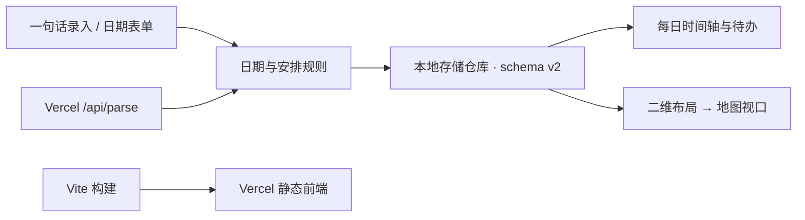

# TimeScape 0.2 架构与地图设计

## 当前已实现

采用 Vite 构建前端，Vercel 承载静态产物和独立 Node Functions。界面、日期领域逻辑、存储、地图布局分别放置，日视图与地图读取同一份安排。保持原浏览器地址和存储键，避免升级造成数据丢失。

| 路径 | 职责 |
| --- | --- |
| `src/app.js` | 编辑、每日视图、完成状态、撤销、备份与界面状态 |
| `src/schedule.js` | 中文日期时间规则、日期区间、按日切分；无 DOM 依赖 |
| `src/data/repository.js` | 数据规范化、校验、旧记录兼容、本地持久化和日期查询 |
| `src/map/layout.js` | 主题分组、日程与待办家族、重叠轨道和连接关系 |
| `src/map/controller.js` | 摄像机坐标、视口裁剪、缩放层级、鼠标、触屏与键盘 |
| `api/parse.js` | 无状态中文识别接口，验证输入长度和基准日期 |
| `api/health.js` | 返回版本和真实的存储模式，不宣称云同步 |
| `vite.config.js` | 构建与本地 API 中间件；本地和线上共用处理函数 |
| `vercel.json` | Vite、`npm ci`、构建命令与 `dist` 输出 |

前端默认直接调用相同的识别规则，不通过网络往返；服务器识别接口已可独立调用。接口不保存安排，不调用模型，也不要求模型密钥。Vercel 上的 Vite 工程可同时使用根目录 `api/` Functions，独立 Node Functions 支持 Web Request/Response 形式的命名方法导出。参考 [Vercel Vite 文档](https://vercel.com/docs/frameworks/frontend/vite) 和 [Node.js Runtime 文档](https://vercel.com/docs/functions/runtimes/node-js)。

## 两个视图如何分工

每日视图回答“今天有哪些安排，要完成什么”：按时间排列，显示当天待办的完成状态；“仅知晓”事项没有完成勾选框。

地图回答“事情在什么时候、属于哪个主题、彼此如何关联”：横向是日期，纵向依次是主题、日程以及关联待办。它与每日视图使用同一条记录，修改任意一处都会更新其他视图。

例如「四级考试」在考试日期，「背单词」在准备日期，两者的横向位置分别对应各自日期；背单词在考试下方，以曲线连接。待办可以早于父日程，关联不限制日期。关联后的待办跟随父日程所在主题区域排列，但保留自身主题颜色。

同时间的日程不会互相覆盖。布局将父日程与其待办作为一个整体，再分配不重叠的纵向轨道；待办之间有冲突时也分行。长事件按日期跨度横向延伸。短事件卡片保留可读宽度，底部细条对应实际持续时间；未指定结束时刻的日程作为时间点处理。

## 缩放与浏览

- 二维摄像机同时变换时间坐标与纵向位置；滚轮和双指缩放围绕操作位置，拖动同时改变两个方向。
- 全局按所有事项的日期范围及纵向高度计算缩放，保留今天的位置，允许跨周、月、年浏览。
- 日期刻度随比例从天切换到周、月、年。远景呈现色块和关系，近景显示名称与时间。
- 纵向采用语义缩放：时间范围很长时，主题和关联行仍保持可辨认的间距；事项很多时再按纵向总高度压缩以容纳全局，避免跨年视野把所有主题挤成一条线。
- 点击主题聚焦该主题；远景点击事项先放大，近景点击打开编辑；点击日期刻度进入当日。
- 地图保留浏览位置。选择日期定位会设置该次新建的默认日期；自由平移及全局视图的中心日期不会擅自改变新建日期。
- 仅创建视口内的事项按钮；用 `requestAnimationFrame` 合并绘制；SVG 绘制网格与关联线，DOM 按钮保留键盘和辅助技术入口。

## 日期模型

一条记录包含 `id/title/kind/category/date/endDate/allDay/start/end/linkId/done`。`kind` 为 `event/task/notice`；目前用「日程／待办／仅知晓」区分行动性质，尚未引入额外的数字优先级。

日期为 `YYYY-MM-DD`，时间为 `HH:mm`。这是用户本地的日历日期与钟表时间，不是 UTC 时间戳；日期运算使用 UTC 日序避免夏令时产生 23 或 25 小时的跨日误差。以后接入跨时区日历，需要单独引入 IANA 时区与瞬时时间语义。

- 全天范围的开始日和结束日均包含在内。
- 有时刻的范围使用 `[开始, 结束)`，跨天记录在所有相交日期可见，结束于次日 `00:00` 时不占次日。
- 当天显示跨天片段：前日开始的片段从 `00:00` 起，延续到后日的片段截至 `24:00`。
- 无结束时间的定时事项只属于开始日；跨天定时事项必须有结束时间。
- 同日结束早于开始时，手动编辑提示改结束日期；自然语言中没有另写结束日期的跨夜时间自动延至次日。
- 旧记录补充 `endDate=date`，根据原时间字段判断全天；编号、分类、关联、完成状态和配色均保留。

## Vercel 状态与后续边界

**已完成的是可构建的工程、函数接口、配置与本地验证。尚未关联 Vercel 项目或发布部署。** 现有连接返回 `oauth_token_invalid_grant`，需要在应用中重新连接 Vercel。源码仓库为 [Guaizai-s/timescape](https://github.com/Guaizai-s/timescape)，项目当前没有 `.vercel` 项目关联、云数据库或认证凭据。

恢复连接后的部署顺序：选定团队与项目 → 关联工程 → 部署 Preview → 检查首页、两个 API 和浏览器交互 → 再发布 Production。现版本无需业务环境变量。可以上传源码部署，也可以连接 Git 仓库自动构建。构建目录为 `dist/`，Node 版本为 24；不要把个人备份、环境文件或本地浏览器数据上传到部署中。

下一阶段云同步建议沿用当前页面与地图，增加认证及 Postgres 仓库：

1. 登录后，安排关联 `owner_id`；所有查询和修改都在服务器校验用户归属。
2. 用数据库替换本地仓库的持久化层，增加 `/api/entries`；Vercel Functions 保持无状态，不向临时文件或进程内数组写持久数据。
3. 增加记录版本、更新时间及删除标记；更新时校验版本，冲突保留双方内容，避免后保存的旧页面覆盖新记录。
4. 先提供本地备份导入，再做离线写入队列与多设备增量同步。数据库密钥只存在服务器环境变量中。

这部分是后续设计，当前没有实现登录、数据库读写或自动同步。中文识别现在是可解释的规则；若以后接模型，规则仍可作为离线回退，模型结果同样必须经过日期校验并供用户确认。
